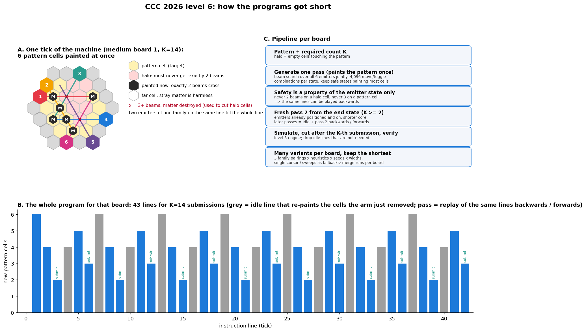

# Level 6 (Nano Fabricator): how the programs got short

Score = total number of instruction lines over all boards, lower is better.
Every board asks for a program that makes the pick-up arm submit a given
pattern K times. All code is in this folder; `python level6.py` regenerates
the outputs (the parallel driver and the per-board merge live in the scratch
scripts, see "Infrastructure").

## Rules that matter

* A cell gets matter when **exactly two** beams cross it, loses it with
  **three or more**. One beam does nothing.
* The arm submits when every pattern cell is matter **and no other matter
  touches the pattern**. Matter far from the pattern is harmless, so stray
  cells are allowed as long as they are not in the *halo* (empty cells
  adjacent to the pattern).
* Six emitters, one per direction, ride on the border. Emitters 1/4 are
  rows, 2/5 one diagonal family, 3/6 the other. Two emitters of the same
  family on the same line put two beams on the whole line: the line fills in
  one tick. Any other beam crossing that line raises its cell to three beams
  and keeps it empty ("cut").
* K submissions need the pattern painted K times (the arm removes it).

## Key idea: safety depends only on the emitter state

Whether a tick is harmless is decided by the emitter positions and on/off
flags alone: never exactly two beams on a halo cell, never three on a pattern
cell. Since F/B/T instructions are invertible, a sequence of safe states can be
played **backwards** and is still safe and paints the same cells. That turns one
pass into K passes cheaply: pass, idle line (re-creates the cells the arm just
removed at that state), the same lines backwards, idle, forwards, ...

## Strategies, in the order they were built

| Step | Idea | Total score |
|---|---|---|
| 1 | Single cursor: two beams from different families cross in one cell; move both emitters one ring step per tick (king moves in line space), route around the halo, order the cells with nearest neighbour + 2-opt. | 65,085 |
| 2 | Greedy painter: four emitters (two families) paint up to four cells per tick, or a whole line with two cuts when the two row emitters coincide. Each tick try all 256 move/toggle combinations, keep the safe one painting the most missing cells. | 34,272 |
| 3 | Variants: two tie-break heuristics, random seeds, one-tick lookahead, line sweeps, pass shortening; keep the shortest verified program per board. | 30,405 |
| 4 | Beam search instead of greedy (keep the N best states per tick). | 24,029 |
| 5 | **Joint search over all six emitters** (4,096 actions per state): line fills plus up to twelve crossings per tick. | 19,023 |
| 6 | Wider beams, more seeds, merged per board over several runs. | 18,473 |
| 7 | **Fresh second pass**: pass 1 is optimised for painting early from the corners; a new beam search from its end state (emitters already placed and on) gives a shorter repeatable core; later passes replay that one. | 17,371 |

Final files: medium 6,652, large 5,596, enormous 5,123 lines. Things that did
not help and are off by default: adaptive beam width in the slow tail, a
six-emitter block-wise greedy, the "cover" heuristic as primary key, line
sweeps as the main strategy, seeding the beam with the sweep's first row fill,
and the pass-shortening local search (passes are already tight line by line).

Every candidate program is re-simulated with the level 5 engine
(`level5.count_submissions`) and must submit exactly K times before it is
written; the program is cut right after the K-th submission and idle lines that
turn out to be unnecessary are removed.

## Why the K-heavy boards dominate

A medium board with 12 cells and K=14 costs 43 lines: setup, then three ticks
per pass (6, 4 and 2 cells; the idle tick itself re-paints 4 to 6 cells, so it
is not wasted). Every line saved in the pass is worth K lines, which is why
the pass core, not the first pass, is what the second-pass search optimises.
On the 297-cell enormous board the first ticks fill whole rows (20, 19, 18
cells) and the last ticks paint one or two cells each; the beam heuristics
(cursor distance, missing cells on active beams) mainly fight over that tail.

## Infrastructure

* `par6.py` (scratch): splits an input over worker processes, largest boards
  first, one `solve_board` call per board with the chosen settings.
* `merge6.py` (scratch): takes several output files for the same input and
  keeps the shortest verified program per board, so every run can only improve
  the committed file.
* Files: `level6.py` (strategies, K-pass assembly, verification),
  `painter.py` (greedy / beam painter), `sweep.py` (line fills, generic state
  evaluator), `shorten.py` (pass local search), `fabricator.py` and
  `hexboard.py` (shared machine and geometry).
